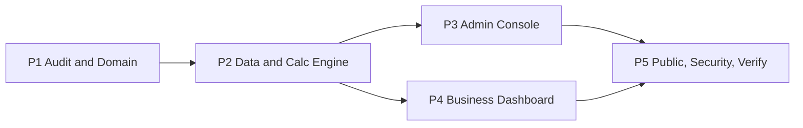

# WPI — Plan Log (5 Phase)

Indeks rencana implementasi **WAVE Waste Price Intelligence (WPI)** untuk AI agent.

Dokumen ini menggantikan `.agents/docs/WPI—Implementation_plan.md` (Phase 0–10) yang sudah dipecah menjadi 5 phase terpisah. Spesifikasi domain bisnis tetap berada di [`../WPI_KNOWLEDGE.md`](../WPI_KNOWLEDGE.md).

---

## Peran AI Agent

Bertindak sebagai **Senior Full-stack Engineer, Software Architect, dan Product Engineer** yang bertanggung jawab mengimplementasikan WPI di dalam aplikasi WAVE yang sudah ada.

- Ikuti aturan coding proyek, konvensi yang ada, dan prinsip *minimal complete implementation*.
- Bangun sistem WPI yang maintainable dan terintegrasi ke aplikasi WAVE.
- **Jangan** membuat ulang aplikasi dari nol.

## Pemisahan Dokumen

| Dokumen | Fungsi |
| --- | --- |
| `WPI_KNOWLEDGE.md` | Logika bisnis: aktor, data, metodologi harga, admin, business, publik. |
| `plan_log/PHASE-*.md` | Instruksi eksekusi per phase + checklist progres + change log. |

Pemisahan ini mencegah agent langsung membuat dashboard/CRUD tanpa memahami logika bisnis WPI.

---

## Status Phase

Update kolom **Status** setiap kali phase berpindah state (`Not Started` / `In Progress` / `Blocked` / `Done`).

| # | Phase | File | Asal (plan lama) | Status |
| --- | --- | --- | --- | --- |
| 1 | Audit & Domain Design | [PHASE-1-AUDIT-DOMAIN.md](./PHASE-1-AUDIT-DOMAIN.md) | Phase 0 + 1 | Done |
| 2 | Data Architecture & Calculation Engine | [PHASE-2-DATA-CALCULATION.md](./PHASE-2-DATA-CALCULATION.md) | Phase 2 + 3 (+ calc tests dari 8) | Done |
| 3 | Admin WPI Console | [PHASE-3-ADMIN-CONSOLE.md](./PHASE-3-ADMIN-CONSOLE.md) | Phase 4 (+ admin workflow tests) | Done |
| 4 | Business WPI Dashboard | [PHASE-4-BUSINESS-DASHBOARD.md](./PHASE-4-BUSINESS-DASHBOARD.md) | Phase 5 (+ org isolation tests) | Done |
| 5 | Public Integration, Security & Final Verification | [PHASE-5-PUBLIC-INTEGRATION-VERIFICATION.md](./PHASE-5-PUBLIC-INTEGRATION-VERIFICATION.md) | Phase 6 + 7 + 8 + 9 + 10 | Not Started |

**Phase aktif saat ini:** Phase 5

Phase 3 dan Phase 4 selesai pada level implementation dan automated verification. Authenticated UI/Convex smoke test belum dijalankan karena environment tidak memiliki credential test Clerk/Convex; catatan ini dipertahankan di masing-masing phase log.



Phase 3 dan Phase 4 boleh berjalan paralel setelah Phase 2 selesai. Phase 5 baru dimulai setelah Phase 3 dan Phase 4 lolos exit criteria.

---

## Arsitektur Target WPI

```text
                    WAVE WPI
                        |
              DATA ACQUISITION
                        |
         +--------------+--------------+
         |              |              |
    Admin Input    Business Data   External Source
         |              |              |
         +--------------+--------------+
                        |
                 VALIDATION ENGINE
                        |
             Accepted / Rejected
                        |
                 WPI CALCULATION
                        |
               Published Snapshot
                        |
         +--------------+--------------+
         |              |              |
     Public WPI     Business WPI    Admin WPI
       Dashboard      Dashboard      Console
```

Prinsip inti: **satu domain pemrosesan harga yang otoritatif**. Public, business, dan admin hanya consumer dengan otorisasi berbeda, bukan tiga sistem terpisah.

Catatan bisnis penting:

- Harga dari bank sampah **tidak otomatis setara** dengan harga transaksi pasar; harga bergantung pada kondisi dan pemilahan material.
- WPI wajib membedakan **harga penawaran (offered)**, **harga referensi (reference)**, dan **transaksi aktual terverifikasi (verified transaction)**.
- Metodologi boleh mengambil prinsip indeks komoditas FAO/IMF, tetapi **tidak boleh** diklaim identik dengan indeks resmi mereka.

---

## Required Context (berlaku untuk semua phase)

Baca sebelum menulis kode:

1. [`../WPI_KNOWLEDGE.md`](../WPI_KNOWLEDGE.md) — spesifikasi domain (diperlakukan sebagai *proposed specification*).
2. `convex/_generated/ai/guidelines.md` — wajib sebelum menyentuh kode Convex.
3. `node_modules/next/dist/docs/` — Next.js versi proyek ini berbeda dari training data.
4. `docs/WAVE_UI_DESIGN_SYSTEM_RULES.md` dan `.agents/docs/typography/` — aturan UI & tipografi.
5. Routing, schema (`convex/schema.ts`), auth, komponen UI, dan implementasi WPI yang sudah ada (`modules/wpi/`, `app/wpi/`).

Jika `WPI_KNOWLEDGE.md` menjelaskan fitur yang belum ada, klasifikasikan sebagai *requirement/proposal*, bukan kapabilitas yang sudah diimplementasikan. **Kode yang ada adalah source of truth** untuk status implementasi aktual.

---

## Execution Rules (global)

1. Mulai dari analisis repository.
2. Jangan mengimplementasikan dari asumsi jika codebase bisa menjawab.
3. Utamakan arsitektur proyek yang sudah ada.
4. Pertahankan desain public WPI yang sudah ada.
5. Pisahkan workflow admin dan business di level presentation.
6. Gunakan **satu** domain kalkulasi WPI bersama.
7. Hindari fitur AI spekulatif.
8. Hindari dependency yang tidak perlu.
9. **Jangan memfabrikasi harga historis.**
10. Jangan mengklaim fungsi yang belum diimplementasikan sebagai selesai.
11. Implementasikan *smallest complete feature* di setiap phase.
12. Jaga fungsi yang sudah berjalan tetap utuh.
13. Update dokumentasi seiring implementasi.
14. Validasi kalkulasi dan permission sebelum mengekspos data publik.

### Urutan vertical slice

Setelah audit, bangun lifecycle minimum secara vertikal:

```text
Observation Submission -> Validation -> Calculation -> Publication -> Public Display
```

Setelah core flow berjalan, baru kembangkan analytics business dan fitur administratif. **Jangan** memulai dengan membuat semua halaman dashboard berisi data statis.

**Success criterion:** satu lifecycle data WPI yang reliable menggerakkan pengalaman public, business, dan admin.

---

## Protokol Progres & Change Log

Setiap file phase memiliki:

1. **Checklist** dengan ID unik (mis. `P2-DATA-03`). Ubah `- [ ]` menjadi `- [x]` saat item benar-benar selesai dan terverifikasi.
2. **Penanda posisi** di atas checklist: `Current step` dan `Last updated`.
3. **Change Log** append-only (entri terbaru di bawah) dengan format:

```markdown
### [YYYY-MM-DDTHH:MM:SS+07:00] <type> — <judul singkat>
- **Type**: feat | fix | issue | chore | refactor | docs | test
- **Files**:
  - `path/to/file.ts` (added | modified | deleted | renamed)
- **Summary**: apa yang berubah secara teknis.
- **Business Context**: dampak ke alur bisnis WPI.
- **Checklist Ref**: <ID item>
- **Notes / Risks**: opsional.
```

Aturan:

- Timestamp **wajib** diambil dari `date --iso-8601=seconds`; jangan dikarang.
- `issue` dipakai untuk mencatat masalah/blocker/temuan meskipun belum ada perubahan file (`Files: -`).
- Setiap item checklist yang dicentang wajib punya minimal satu entri change log yang merujuk ID-nya.
- Saat phase selesai, update tabel **Status Phase** di README ini dan tambahkan entri `docs` di change log README.

### Definisi tipe

| Type | Dipakai untuk |
| --- | --- |
| `feat` | Kapabilitas baru (schema, query, mutation, halaman, komponen). |
| `fix` | Perbaikan bug pada perilaku yang sudah ada. |
| `issue` | Temuan masalah, risiko, blocker, atau keputusan bisnis yang belum jelas. |
| `chore` | Konfigurasi, dependency, script, housekeeping tanpa perubahan perilaku. |
| `refactor` | Restrukturisasi kode tanpa perubahan perilaku. |
| `docs` | Dokumentasi (`docs/wpi/*`, plan log). |
| `test` | Penambahan/perubahan test. |

---

## Change Log

### [2026-10-24T18:14:59+07:00] docs — Inisialisasi plan log WPI 5 phase
- **Type**: docs
- **Files**:
  - `.agents/docs/plan_log/README.md` (added)
- **Summary**: Membuat indeks plan log yang menggantikan `WPI—Implementation_plan.md` (Phase 0–10) menjadi 5 phase, beserta execution rules global, arsitektur target, dan protokol change log.
- **Business Context**: Memastikan AI agent memahami logika bisnis WPI (perbedaan harga penawaran, referensi, dan transaksi aktual) sebelum membangun dashboard/CRUD, dan progres implementasi bisa dilacak per phase.
- **Checklist Ref**: -
- **Notes / Risks**: -

### [2026-10-24T18:31:48+07:00] docs — Menandai Phase 1 selesai
- **Type**: docs
- **Files**:
  - `.agents/docs/plan_log/README.md` (modified)
- **Summary**: Mengubah status Phase 1 menjadi Done dan menetapkan Phase 2 sebagai phase aktif setelah seluruh exit criteria audit terpenuhi.
- **Business Context**: Implementasi berikutnya dapat mulai membangun schema dan calculation engine berdasarkan model domain, flow, dan access boundary yang sudah diaudit.
- **Checklist Ref**: P1-DOC-01–04 dan seluruh Phase 1 exit criteria
- **Notes / Risks**: Keputusan platform-admin dan definisi seri reference/gold masih harus diselesaikan sebelum data sensitif atau reference price dipublikasikan.

### [2026-10-24T18:35:08+07:00] feat — Menandai Phase 2 selesai
- **Type**: feat
- **Files**:
  - `.agents/docs/plan_log/README.md` (modified)
- **Summary**: Mengubah status Phase 2 menjadi Done dan menetapkan Phase 3 sebagai phase aktif setelah schema, engine, API, test, dan exit criteria terpenuhi.
- **Business Context**: Fondasi data WPI siap dipakai console admin dan dashboard business dengan satu calculation engine dan publication boundary.
- **Checklist Ref**: P2-DATA-01–06, P2-INT-01–08, P2-CALC-01–13, P2-TEST-01–12, P2-DOC-01–03
- **Notes / Risks**: Admin review queue dan candidate calculation orchestration belum dibuat; keduanya scope Phase 3.

### [2026-10-24T18:48:03+07:00] docs — Menandai Phase 3 dan Phase 4 selesai
- **Type**: docs
- **Files**:
  - `.agents/docs/plan_log/README.md` (modified)
  - `.agents/docs/plan_log/PHASE-3-ADMIN-CONSOLE.md` (modified)
  - `.agents/docs/plan_log/PHASE-4-BUSINESS-DASHBOARD.md` (modified)
- **Summary**: Memperbarui checklist dan status Phase 3–4 menjadi Done, menetapkan Phase 5 sebagai phase aktif, dan mencatat hasil verifikasi implementation.
- **Business Context**: Lifecycle WPI sekarang memiliki entry point business, quality gate admin, calculation candidate, dan publication boundary sebelum public integration.
- **Checklist Ref**: seluruh item Phase 3 dan Phase 4
- **Notes / Risks**: Authenticated smoke test belum dijalankan tanpa credential test environment. `pnpm build` lulus dengan warning security advisory Next.js dan warning chart dimension yang sudah ada.

### [2026-10-24T18:48:03+07:00] issue — Upgrade keamanan Next.js masih pending
- **Type**: issue
- **Files**: -
- **Summary**: Production build lulus tetapi mengeluarkan peringatan bahwa Next.js 16.4.0 memiliki security vulnerability yang perlu ditangani lewat upgrade terarah.
- **Business Context**: Tidak mengubah alur WPI Phase 3–4, tetapi upgrade perlu dilakukan sebelum deployment production agar surface keamanan aplikasi tetap terjaga.
- **Checklist Ref**: -
- **Notes / Risks**: Jangan menjalankan upgrade dependency tanpa keputusan eksplisit karena dapat mengubah lockfile dan behavior aplikasi di luar scope phase.

### [2026-10-24T18:49:44+07:00] docs — Sinkronisasi arsitektur exclusion provenance
- **Type**: docs
- **Files**:
  - `docs/wpi/05-DATA-ARCHITECTURE.md` (modified)
  - `.agents/docs/plan_log/PHASE-3-ADMIN-CONSOLE.md` (modified)
- **Summary**: Menyamakan dokumentasi arsitektur dengan tabel exclusion yang sekarang dipakai calculation candidate dan admin inspection.
- **Business Context**: Keputusan kualitas data tetap dapat diaudit dan dijelaskan kepada operator WAVE.
- **Checklist Ref**: P3-CALC-03
- **Notes / Risks**: -

### [2026-10-24T18:51:16+07:00] fix — Mengunci duplicate fingerprint submission
- **Type**: fix
- **Files**:
  - `convex/wpi/observations.ts` (modified)
  - `convex/wpi/workflow.ts` (modified)
  - `modules/wpi/business-dashboard.tsx` (modified)
  - `tests/wpi/workflow.test.ts` (modified)
- **Summary**: Menambahkan canonical fingerprint validation di server dan test deterministik agar duplicate observation tidak dapat dilewati dari client.
- **Business Context**: Integritas data acquisition WPI lebih kuat sebelum observasi masuk review queue.
- **Checklist Ref**: P4-SUB-02, P4-SUB-04, P4-TEST-01–02
- **Notes / Risks**: -

### [2026-10-24T18:57:07+07:00] chore — Preflight Phase 5 selesai
- **Type**: chore
- **Files**:
  - `next.config.ts` (modified)
  - `package.json` (modified)
  - `pnpm-lock.yaml` (modified)
  - `pnpm-workspace.yaml` (modified)
  - `.agents/docs/plan_log/PHASE-5-PUBLIC-INTEGRATION-VERIFICATION.md` (modified)
- **Summary**: Security upgrade Next.js 16.4.0 -> 16.4.3 selesai dan diverifikasi di branch `codex/security-next-upgrade`, lalu di-fast-forward ke `codex/wpi-phase5-ready`. Preflight Phase 5 dicatat tanpa menandai implementasi public sebagai selesai.
- **Business Context**: Baseline Phase 5 aman untuk mulai menghubungkan public WPI ke snapshot published tanpa mencampur pekerjaan public dengan branch admin/business.
- **Checklist Ref**: P5-PREFLIGHT-01–04
- **Notes / Risks**: Public UI masih memakai mock data; ini adalah scope utama Phase 5.
