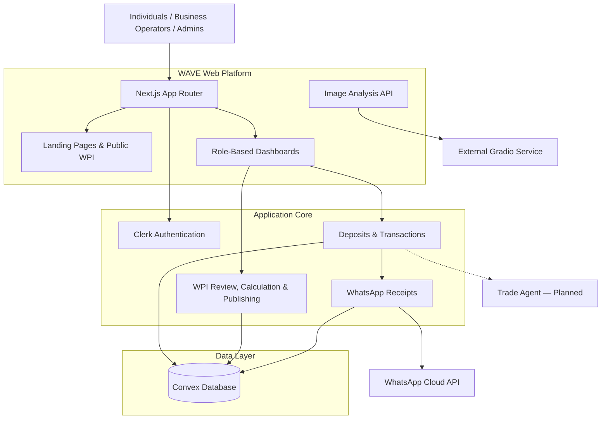
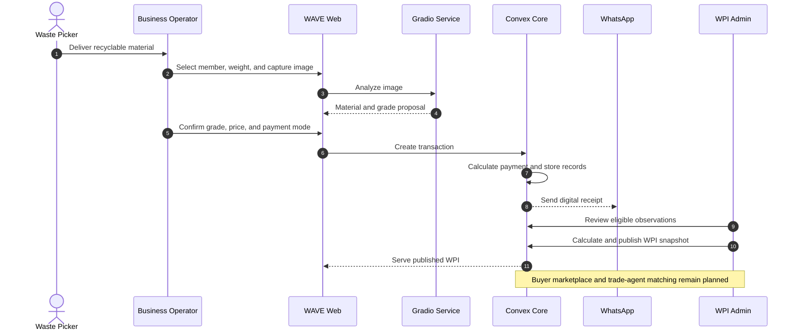

# WAVE

WAVE is a web application for recording recyclable-material deposits and publishing a Waste Price Index (WPI). It provides individual, business, and admin workspaces backed by Clerk authentication and Convex.

## The Solution

WAVE introduces an integrated ecosystem built around four complementary capabilities.

### 1. Waste Price Index (WPI)

Public reference prices, historical charts, price movements, and material information for `PET`, `HDPE`, `PP`, `OCC`, `Aluminium`, and `Iron`. Published data distinguishes validated transaction prices from reference prices.

> Demo or simulated data is not presented as independently verified market data.

### 2. AI-Powered Visual Inspection

The business intake flow sends a captured image to an external Gradio service, receives a material and grade A/B/C proposal, then requires operator confirmation. The feature assists rather than replaces human inspection.

### 3. Agentic Trade Orchestration

_Planned._ AI-assisted inventory and buyer matching with human approval. No trade-agent or buyer marketplace implementation currently exists in this repository.

### 4. Inclusive Price Transparency

After Convex records a deposit, it schedules a WhatsApp receipt containing the material, weight, grade, prices, and payment values.

## Features

| Feature                                           | Status                                     |
| ------------------------------------------------- | ------------------------------------------ |
| Landing pages, WPI, and material details          | Implemented                                |
| Clerk auth, onboarding, role guards, and sign-out | Implemented                                |
| Individual dashboard                              | Implemented; deposit data is not connected |
| Business intake, transactions, void, and members  | Implemented                                |
| Image analysis through Gradio                     | Implemented; requires an external service  |
| WPI admin review, calculation, and publishing     | Implemented                                |
| WhatsApp receipts through Convex                  | Implemented                                |
| B2B buyer marketplace and AI trade agent          | Planned                                    |

## Architecture

WAVE follows a modular monolith: Next.js handles the web application and image-analysis API, Clerk handles identity, and Convex provides the database and transactional/realtime backend.

### High-Level Architecture



Dashed connections represent planned capabilities.

### End-to-End Workflow



### Architecture Principles

- **Modularity:** auth, dashboard, transactions, WhatsApp, and WPI have separate domain modules.
- **Human-in-the-loop:** operators confirm AI-assisted grading; admins review and publish WPI data.
- **Single source of truth:** Convex stores operational records and published WPI data.
- **Authorization:** backend access is scoped by user role and organization.

## Tech Stack

| Layer                 | Technology                                        |
| --------------------- | ------------------------------------------------- |
| Web                   | Next.js 16, React 19, TypeScript                  |
| UI                    | Tailwind CSS, Base UI, shadcn components          |
| Auth                  | Clerk                                             |
| Backend & data        | Convex                                            |
| Image analysis client | Gradio client; external service required          |
| Testing               | Vitest, convex-test, Node test runner, Playwright |

## Repository Structure

```text
app/         Next.js routes and image-analysis API
components/  shared UI components
modules/     auth, dashboard, landing-page, and WPI features
convex/      schema, auth, transactions, WhatsApp, and WPI backend
lib/         transaction rules and shared utilities
tests/       unit and Playwright tests
```

## Local Development

Prerequisites: Node.js, pnpm, a Convex project, and a Clerk application.

```bash
pnpm install
cp .env.example .env
```

Configure Clerk and Convex using `.env.example`. For Convex authentication, create a Clerk JWT template named `convex`, then set its issuer on the Convex deployment:

```bash
npx convex env set CLERK_JWT_ISSUER_DOMAIN https://<clerk-frontend-api>
```

Run the backend and web application in separate terminals:

```bash
npx convex dev
```

```bash
pnpm dev
```

The application is available at `http://localhost:3000`.

### Optional Integrations

- Image analysis: set `GRADIO_API_URL` in the Next.js environment. `POST /api/analyze-waste` only accepts authenticated business/admin users.
- WhatsApp: set `WHATSAPP_ACCESS_TOKEN`, `WHATSAPP_PHONE_NUMBER_ID`, and `WHATSAPP_VERIFY_TOKEN` in the Convex deployment environment. Webhook callback: `https://<deployment>.convex.site/whatsapp/webhook`.
- Playwright auth: set `WAVE_TEST_*` locally. Never store real credentials in `.env.example`.

## Commands

```bash
pnpm dev          # development server
pnpm build        # production build
pnpm typecheck    # TypeScript
pnpm lint         # ESLint
pnpm test:unit    # WPI unit tests
pnpm test:convex  # Convex function tests
pnpm exec playwright test tests/auth # authentication E2E
```

## Current Limitations

- Individual deposit data is not yet connected to Convex transactions.
- The business transaction list loads at most the latest 200 records.
- The WhatsApp webhook does not yet verify `X-Hub-Signature-256`.
- This repository does not yet contain billing, a buyer marketplace, or an AI trade agent.

Never commit secrets, tokens, or test credentials. Follow `AGENTS.md` before modifying the codebase.
