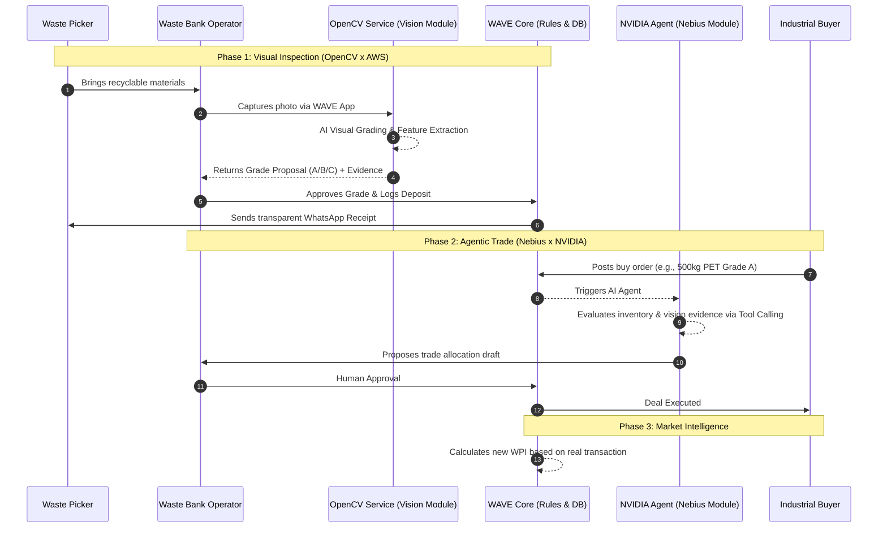

# WAVE — Waste Value Exchange

WAVE is a transparent market intelligence and B2B trading platform designed for the circular economy. It empowers informal waste pickers by providing a public Waste Price Index (WPI), utilizes Computer Vision for objective material grading, and orchestrates trades using AI Agents.

## Visual Identity

### Logo


The WAVE logo combines the wordmark “WAVE” with a friendly animal mascot resembling a cow or buffalo. The mascot represents WAVE’s proximity to communities and field operators, while the bold wordmark communicates strength, movement, and the circulation of value within the recycling ecosystem.

The logo uses a monochrome style with a transparent background. It can be displayed in black on light backgrounds and in white/inverted form on dark backgrounds.

### Colors

WAVE’s color palette is dominated by shades of green to represent the environment, sustainability, growth, and the circular economy.

| No. | Color | Hex Code | Meaning |
| --- | --- | --- | --- |
| 1 | WAVE Green | `#245A32` | Primary brand color representing sustainability, trust, and circular economic growth. |
| 2 | Deep Green | `#102815` | Represents stability, professionalism, security, and a strong ecosystem. |
| 3 | Sage Green | `#86AD7E` | Represents balance, environmental recovery, collaboration, and harmony. |
| 4 | Pale Green | `#EFF5EC` | Provides a clean, light, and environmentally friendly interface background. |
| 5 | Off White | `#F7FAF5` | Represents transparency, cleanliness, openness, and ease of use. |
| 6 | Coral | `#BF5B5A` | Accent and warning color representing attention, urgency, and actions that require review. |
| 7 | Gold | `#8D7239` | Represents economic value, material quality, commodity pricing, and value creation. |
| 8 | Muted Green Gray | `#647466` | Used for secondary information and supporting text in a neutral, readable way. |

### Typography

WAVE uses a modern and accessible type system to support both business operations and community-oriented users.

| Font | Usage | Meaning |
| --- | --- | --- |
| Plus Jakarta Sans | Headings, body text, navigation, buttons, and primary interface information. | Modern, professional, friendly, and highly readable. |
| JetBrains Mono | Lapak codes, member codes, transaction numbers, prices, and technical information. | Precise, structured, technical, and trustworthy. |

Plus Jakarta Sans is the primary interface font, while JetBrains Mono is used for data that requires accurate character-by-character reading.

## The Problem

In developing countries like Indonesia, the waste recycling supply chain is heavily dependent on informal waste pickers.
- Information asymmetry: Waste pickers are passive price-takers. Prices are dictated by middlemen without any public reference.
- Subjective grading: Quality assessment of raw recyclable materials is done manually, often resulting in unfair price deductions.
- Fragmented trading: Waste banks struggle to find the right industrial buyers and fail to time the market correctly due to the lack of predictive analytics.

## The Solution

WAVE acts as a stock exchange for recyclable materials. It consists of:

- WPI (Waste Price Index): A real-time benchmark price derived from actual, validated industrial transactions.
- AI Visual Inspection: OpenCV-powered grading (A/B/C) to provide objective evidence of material quality before transactions.
- Agentic Trade Orchestration: Nebius/NVIDIA-powered AI Agents that read industrial demands, evaluate warehouse stocks, and draft optimized transaction allocations.
- Inclusive Transparency: Waste pickers receive digital receipts via WhatsApp (comparing the Market Price vs. Paid Price) without needing to install any app.

## Architecture & Flow
WAVE is built as a Modular Monolith to support multiple hackathon submissions within a single, maintainable repository. We use a Feature Flag & UI Slots approach to dynamically load specific AI components (Vision vs. Agent) without cluttering the client bundle.



## Tech Stack

### Core Platform

- Frontend: Next.js App Router, React, TailwindCSS, dan Shadcn UI
- Database dan real-time data: Convex
- Language: TypeScript

### AI dan Python Runtime

- Computer Vision: Python, FastAPI, OpenCV, dan AWS
- Agent orchestration: Nebius AI Cloud, NVIDIA open-source LLM, dan tool calling

## Repository Structure

```text
/wave-monorepo
 ├── /src
 │    ├── /core                  # Shared business logic, Convex DB schemas, UI layouts
 │    ├── /modules
 │    │    ├── /vision           # OpenCV components, AWS integrations, camera UI
 │    │    ├── /agent            # NVIDIA AI Agent chat UI, Nebius integration
 │    │    └── /transaction      # Shared ledger and B2B trade components
 │    └── /app                   # Next.js pages with UI Slots & Dynamic Imports
 │
 ├── /services
 │    └── /vision-api            # Python FastAPI service for OpenCV image processing
 │
 └── .env.example                # Environment variables (including Feature Flags)
```

## Getting Started

### 1. Clone the Repository

```bash
git clone https://github.com/your-org/wave-platform.git
cd wave-platform
```

### 2. Environment Setup

Copy the example environment file:

```bash
cp .env.example .env.local
```

Set the active module in `.env.local` to determine which AI feature to compile:
```env
# Set to 'OPENCV', 'NEBIUS', or 'FULL'
NEXT_PUBLIC_ACTIVE_MODULE=FULL
```

### 3. Install Dependencies and Run Core App

```bash
pnpm install
pnpm dev
```

The Convex backend will automatically sync with your local environment.

### 4. Run Python Vision Service

```bash
cd services/vision-api
python -m venv venv
source venv/bin/activate  # On Windows: venv\Scripts\activate
pip install -r requirements.txt
uvicorn main:app --reload
```
